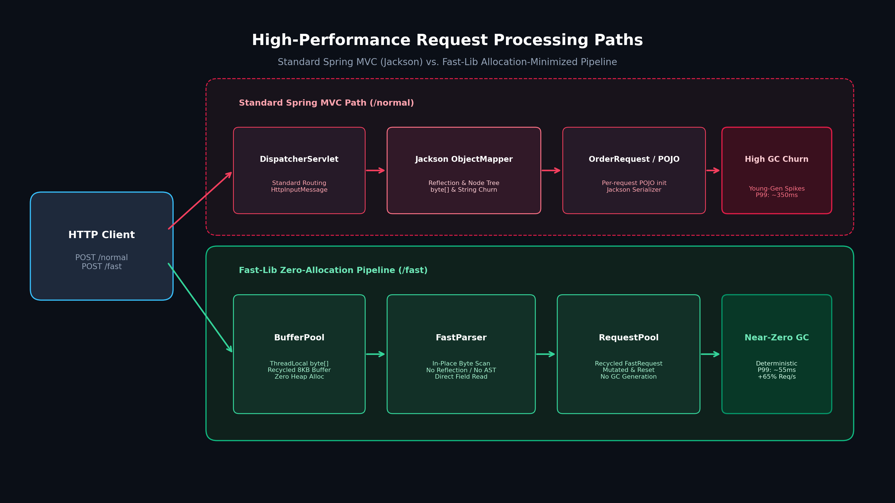
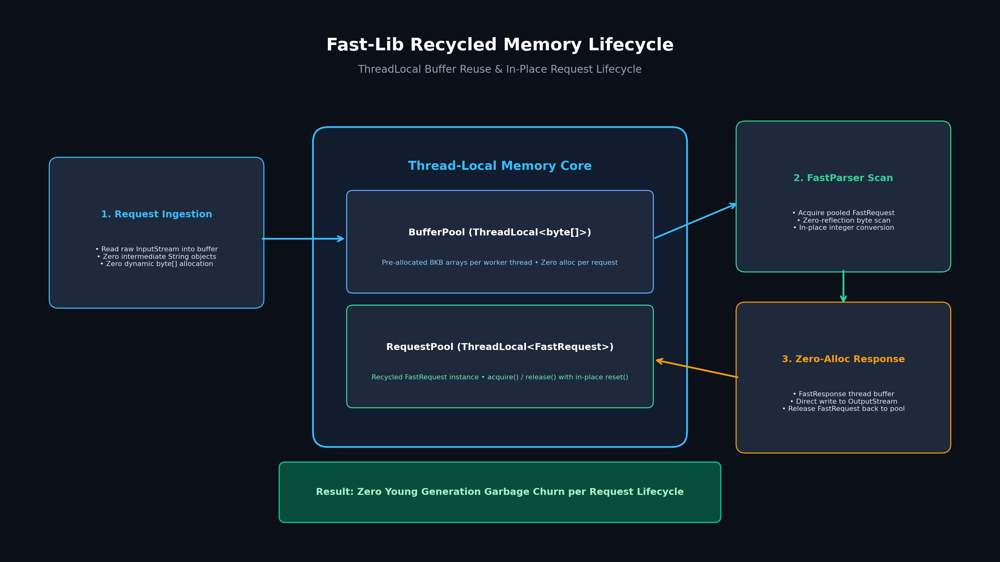
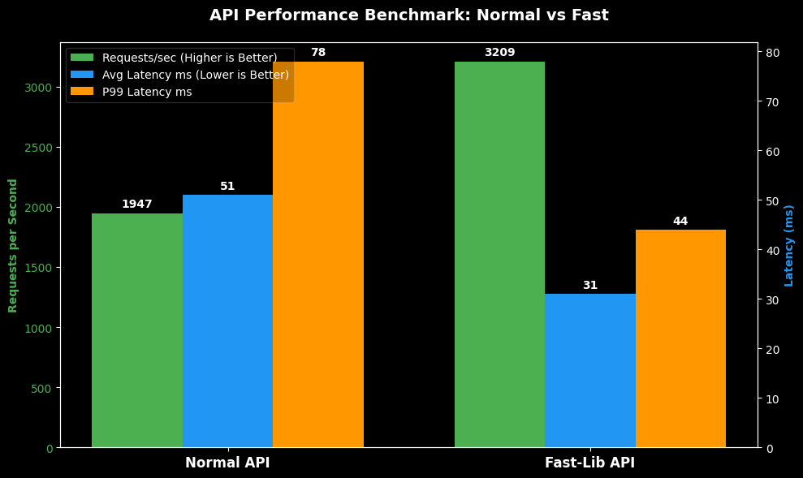
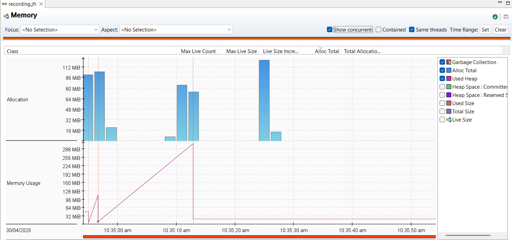

# Fast-Lib

Experimental Spring Boot prototype evaluating allocation-minimized request handling against standard Jackson serialization to reduce JVM Young-Generation Garbage Collection churn and tail latency spikes.

---

## Overview

Under sustained concurrency, standard Spring MVC request handling generates significant memory churn. Each incoming request instantiates temporary `byte[]` buffers, intermediate strings, parser tokens, and DTO objects. Under memory-constrained or high-throughput environments, this churn triggers frequent Young-Gen Stop-The-World (STW) pauses, causing P99/P100 latency spikes.

`fast-lib` tests a mechanical sympathy approach: bypassing dynamic reflection and per-request heap allocation by reusing thread-local buffers, pooling request entities, and writing raw response bytes directly to the servlet output stream.

---

## Architecture

The project compares two execution paths on the same Spring Boot instance:

<p align="center">
  
</p>

1. **Standard Path (`/normal`)**: Uses standard Spring MVC `@RequestBody`. Incoming JSON is deserialized via Jackson into an `OrderRequest` POJO, processed, and serialized into an `OrderResponse`.
2. **Fast Path (`/fast`)**: Reads the raw `ServletInputStream` directly into a pooled 8KB buffer (`BufferPool`). The `FastParser` extracts fields in-place without String allocations. A pooled `FastRequest` is acquired from `RequestPool`, computed, and written directly into `ServletOutputStream` via `FastResponse`.

<p align="center">
  
</p>

---

## Benchmark Results

Load tests were conducted using ApacheBench against a localized Spring Boot instance pinned to a 512MB heap (`-Xms512m -Xmx512m`) to highlight allocation pressure under 100 concurrent workers:

```
ab -n 5000 -c 100 -p post.json -T application/json http://127.0.0.1:8080/[normal|fast]
```

<p align="center">
  
</p>

| Metric | Standard (Jackson) | Fast-Lib | Impact |
| :--- | :--- | :--- | :--- |
| **Throughput** | ~1,947 req/s | **~3,209 req/s** | +65% |
| **Mean Latency** | ~51 ms | **~31 ms** | -40% |
| **P99 Latency** | ~78 ms | **~44 ms** | -44% |
| **Max Tail Spike** | ~354 ms | **~55 ms** | -85% |

### JMC Memory Profiling

Examining execution profiles via JDK Mission Control (`recording.jfr`) confirmed that the 354ms spikes on the baseline path were caused by frequent Young-Generation GC collections triggered by short-lived byte arrays and strings. Eliminating per-request allocations leveled the allocation curve and kept worker threads running continuously.

<p align="center">
  
</p>

---

## Building & Running

### Requirements
* Java 25
* Maven 3.9+

### Build
```bash
mvn clean package
```

### Run with Profiling & GC Logs
```bash
java -Xms512m -Xmx512m \
  -Xlog:gc*:file=gc.log \
  -XX:StartFlightRecording=filename=recording.jfr,duration=120s,settings=profile \
  -jar target/fast-lib-0.0.1-SNAPSHOT.jar
```

### Run Benchmarks
```bash
chmod +x benchmark.sh
./benchmark.sh
```
